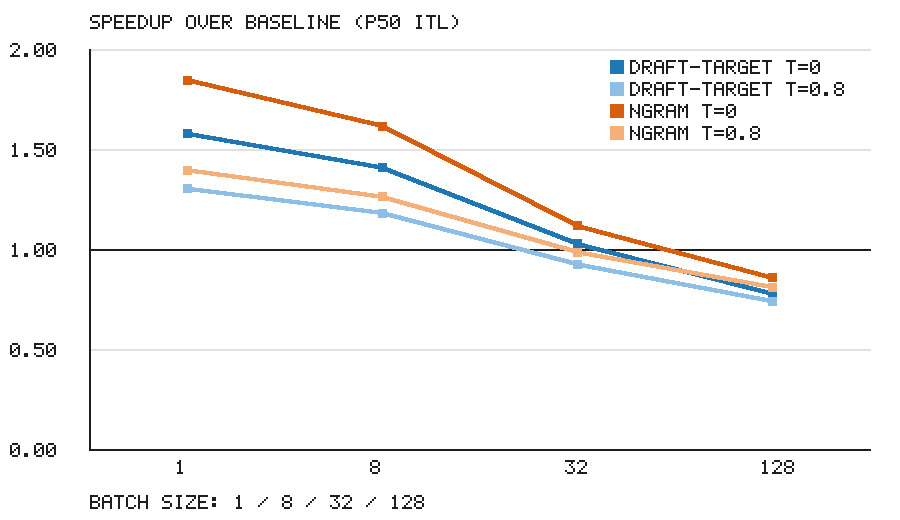
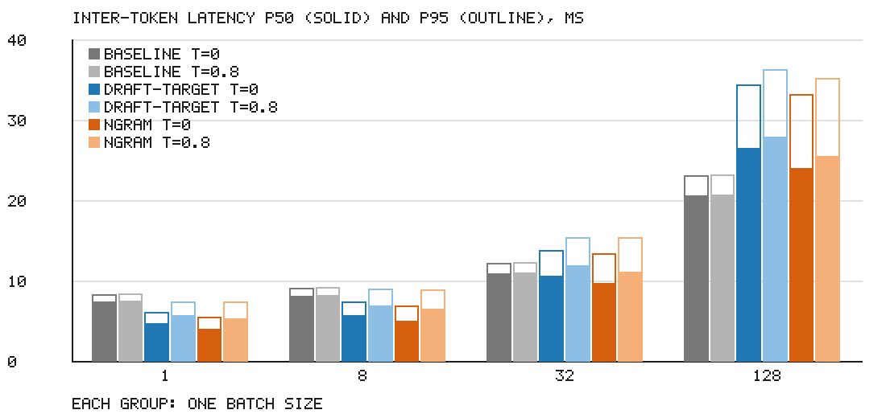
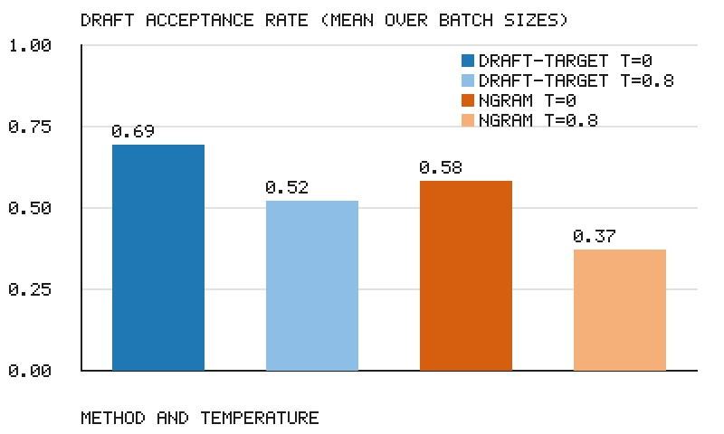

# Speculative decoding on a code-revision workload

## Decision

Turn on n-gram speculation for the code-revision endpoint, and cap the running batch at 8 while it is on. At batch 1 and temperature 0 it cuts P50 inter-token latency from 7.4 ms to 4.0 ms (1.85x), and at batch 8 from 8.1 ms to 5.0 ms (1.62x). Above batch 8 the gain fades: 1.12x at batch 32, and at batch 128 n-gram is slower than no speculation (23.95 ms against 20.6 ms). Skip draft-target: it trailed n-gram in every one of the eight speculative cells and added 5.7 ms to P50 TTFT at batch 1. At temperature 0.8, n-gram still pays at batch 1 (1.40x) and batch 8 (1.27x), so the same rule holds.

## Setup

| | |
| --- | --- |
| Target model | Qwen/Qwen2.5-7B-Instruct (7.6B) |
| Draft model | Qwen/Qwen2.5-0.5B-Instruct (0.49B, about 15x smaller) |
| Engine | vLLM 0.10.2, BF16, max model length 4096, max 128 sequences |
| GPU | 1x H100 SXM 80GB, rented by the hour |
| Prompts | 164 HumanEval problems with their reference solutions, framed as "revise this function" requests; mean input 412 tokens |
| Output | 256 tokens per request (`min_tokens` = `max_tokens`) |
| Draft tokens per step | 4 for draft-target, 5 for n-gram (prompt lookup of 2 to 4 tokens) |

`scripts/launch.sh` holds the three launch commands. `scripts/make_prompts.py` builds the prompt file. The GPU run needs `requirements-gpu.txt`; the dry run needs nothing beyond the standard library.

## Method

I launched vLLM once per method and ran the full grid against it with `python -m bench --method <name>`: batch 1, 8, 32 and 128 at temperature 0 and 0.8. The client holds batch-size streams open at once, so the engine's running batch stays at that size for most of each run. Every cell starts with 16 warm-up requests that never reach the numbers, then measures 200 requests (256 at batch 128, so the batch fills twice).

For each request the client records time to first token and the mean gap between later tokens. Per cell I report P50 and P95 of both, per-user tokens per second at P50, and total output tokens per second over the cell's wall time. Acceptance rate comes from vLLM's speculative decoding counters on `/metrics`, read before and after each cell. `scripts/merge.py` combines the three method files into `results.json`.

`make check` runs the same grid, summary, checks and charts with `--dry-run`. A pair of toy models over a 64-token vocabulary replaces the GPU, and a simulated clock charges each decode step one pass over the weights plus compute per token in the batch.

## Results

Speedup is baseline P50 inter-token latency divided by the method's P50 at the same batch size and temperature.

| Batch | n-gram T=0 | n-gram T=0.8 | draft-target T=0 | draft-target T=0.8 |
| --- | --- | --- | --- | --- |
| 1 | 1.85x | 1.40x | 1.58x | 1.31x |
| 8 | 1.62x | 1.27x | 1.41x | 1.18x |
| 32 | 1.12x | 0.99x | 1.03x | 0.93x |
| 128 | 0.86x | 0.81x | 0.78x | 0.74x |

**Batch size.** At batch 1 the GPU spends each decode step reading weights, with compute to spare, so verifying five extra tokens costs little. By batch 128 the baseline step already takes 20.6 ms at P50 against 7.4 ms at batch 1, which tells me compute is the limit there. Speculation then adds verification work to a step that has no slack, and total throughput falls from 5861.9 to 5042.0 tokens per second with n-gram on.

**Tails.** Speculation widens the spread between P50 and P95, because a step that accepts nothing yields one token while a lucky step yields six. At batch 1 and temperature 0 the n-gram P95 is 5.52 ms, still below the baseline P50 of 7.4 ms.

**Temperature.** Acceptance drops from 0.58 to 0.37 for n-gram and from 0.69 to 0.52 for draft-target when temperature goes from 0 to 0.8. Fewer accepted tokens per step means less gain, which matches the speedup table.

**Why n-gram wins here.** Revision output repeats most of the input function, so the prompt holds the right continuation for long stretches. Draft-target has the higher acceptance rate, but each step runs four sequential draft passes before verification, and the draft model prefills every prompt as well: P50 TTFT at batch 1 rises from 41.0 ms to 46.7 ms with draft-target and to 41.8 ms with n-gram.

## Limitations

- I measured one GPU type, one engine version and one prompt set. Chat prompts that do not echo their input would give n-gram far fewer matches.
- I did not measure batch 16, so I cannot place the cutoff between 8 and 32 more precisely.
- Acceptance rate is a per-cell aggregate from engine counters, not a per-request figure.
- Forcing 256 output tokens removes early stops, which production requests have.
- I left EAGLE out because it needs a trained speculator for this model.
